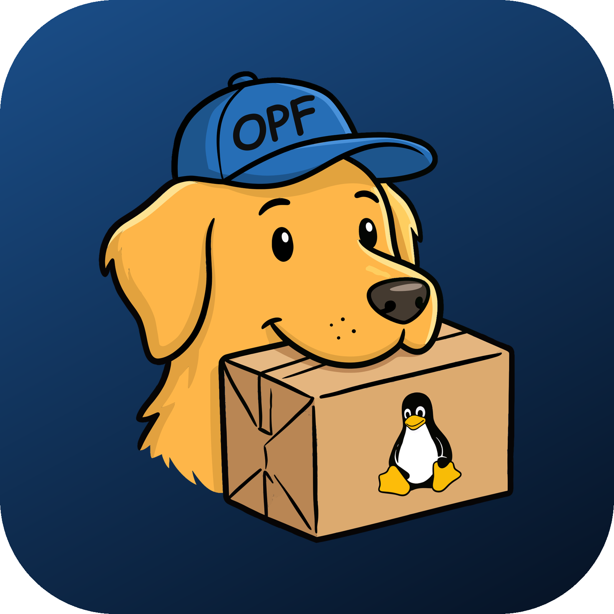
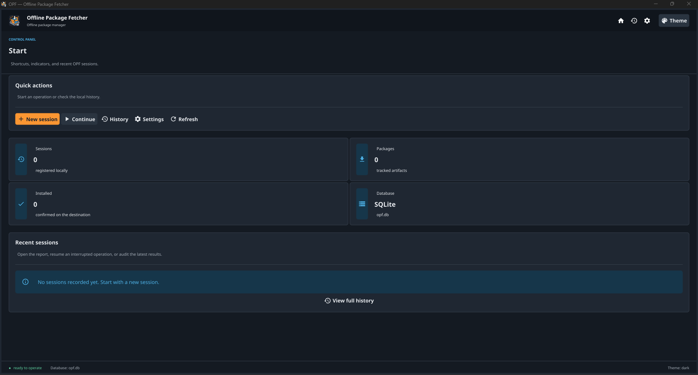
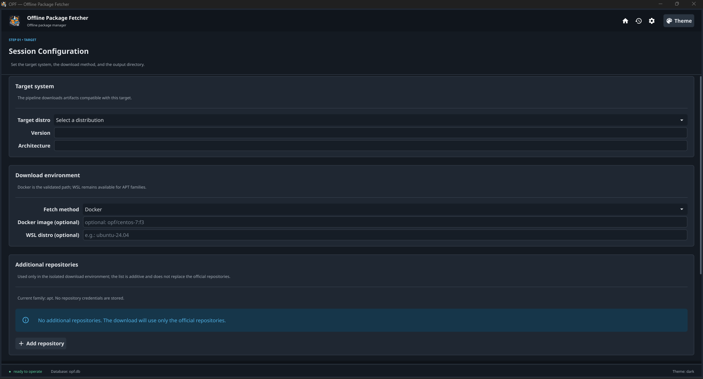
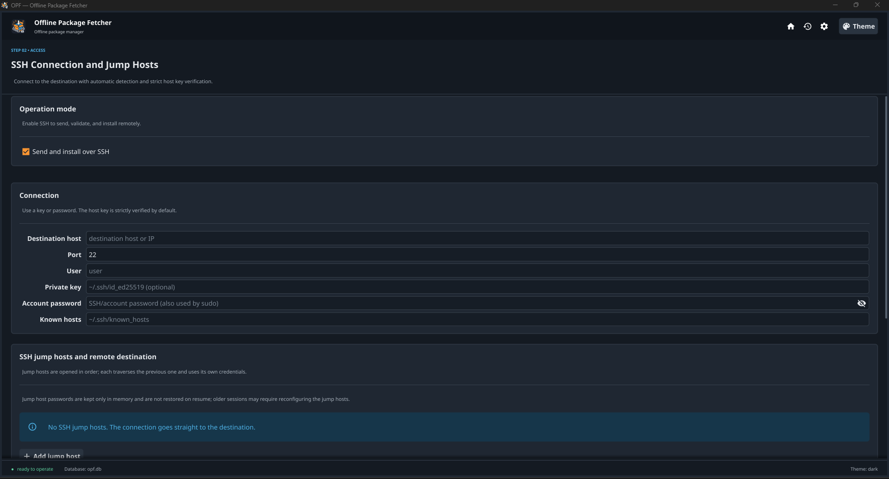
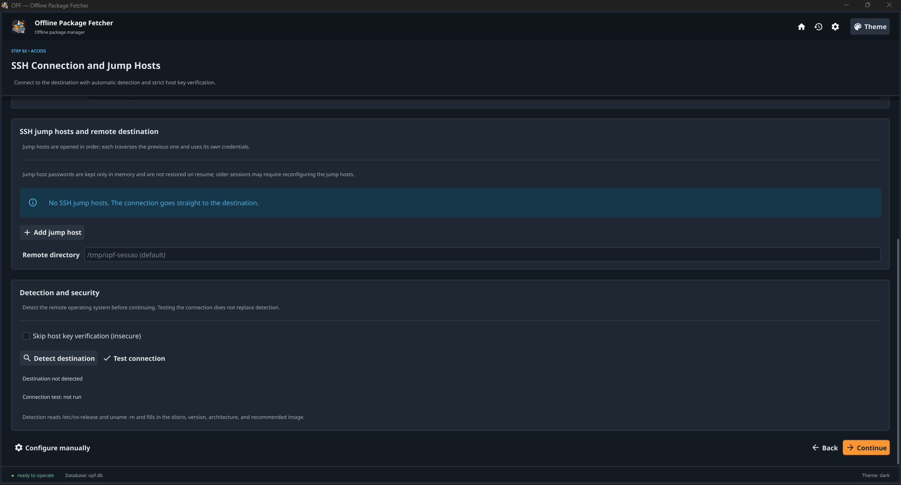
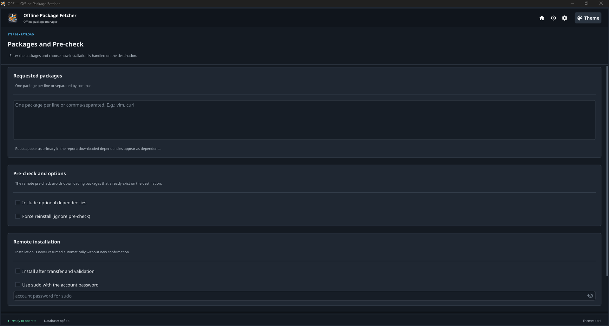
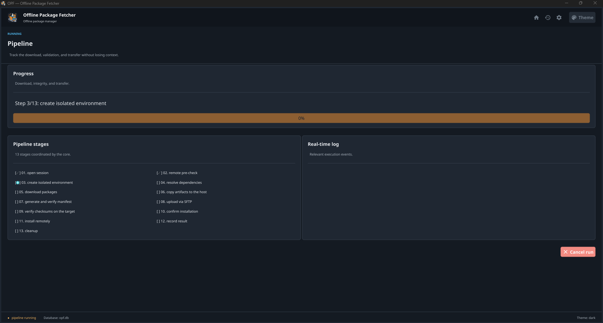
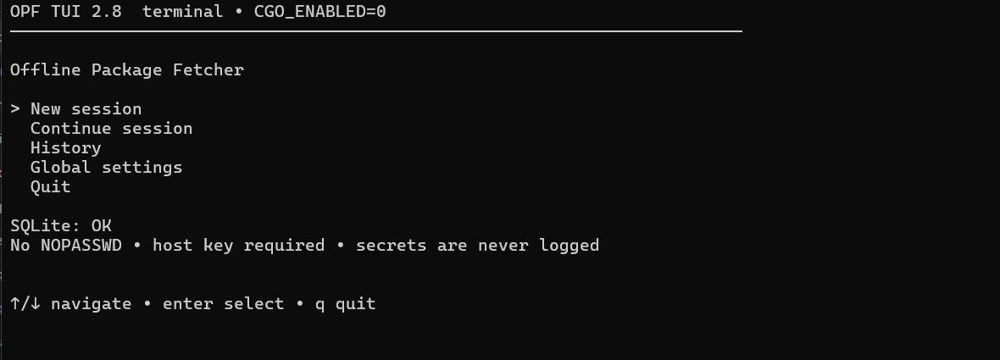
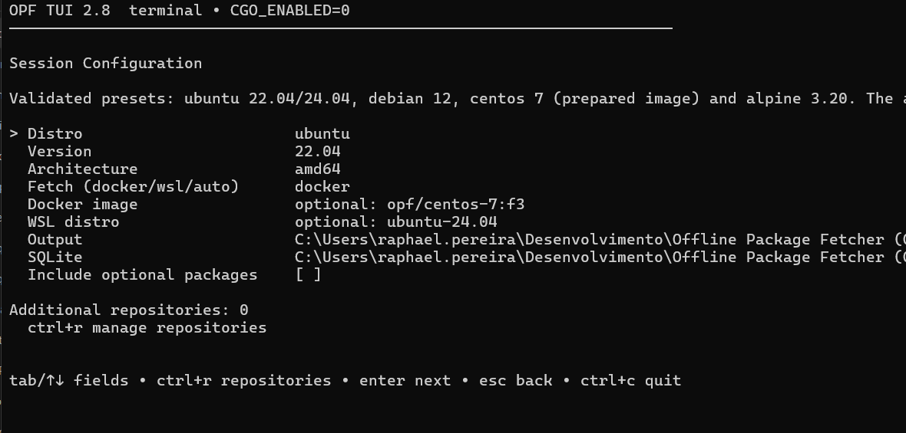

**English** | [Português (BR)](docs/README.pt-BR.md)

[](https://github.com/ph7ti/Offline-Package-Fetcher/actions/workflows/ci.yml)
[](https://github.com/ph7ti/Offline-Package-Fetcher/releases/latest)
[](https://go.dev/dl/)
[](LICENSE)

<p align="center">
  
</p>

# Offline Package Fetcher (OPF)

**Download Linux packages and their complete dependency closure for isolated environments — and, when it makes sense, ship them over SSH/SFTP and install them on the target.**

Version **0.3.0** (development) · License **GPL-3.0** · Go **1.27.4** · Linux, Windows and macOS (secondary)

---

## Overview

**Offline Package Fetcher (OPF)** is a Go tool that automates the **download → verification → transfer → installation** cycle for Linux packages and every dependency they need. Packages are resolved and downloaded inside an **isolated environment** built from the exact same image (Docker) or distribution (WSL) as the target, so the artifacts are guaranteed to match the server that will receive them.

OPF ships three fronts that share one core:

| Front | Binary | Interface | Build |
|:---|:---|:---|:---|
| CLI | `opf-cli` | POSIX flags, ideal for scripts and pipelines | `CGO_ENABLED=0` |
| TUI | `opf-tui` | interactive terminal (Bubble Tea) | `CGO_ENABLED=0` |
| GUI | `opf-gui` | desktop (Fyne) | `CGO_ENABLED=1` + graphics libraries |

## The problem OPF solves

Isolated environments (network segments without internet, customers behind a blocking proxy, validation labs) cannot resolve dependencies: the target package manager only fails at install time, when there is no way left to download what is missing. The result is a trial-and-error loop with physical media or maintenance windows.

OPF removes that rework because it:

- resolves the dependency tree **before** leaving the connected environment;
- downloads everything **once**, including optional dependencies when requested;
- verifies integrity **three times** (isolated environment, host and target);
- delivers the files over SFTP and, if the operator confirms, installs them on the target;
- records every session in SQLite and can export an auditable report.

A session in short:

```
1. you provide target + packages       →  2. OPF opens the session in SQLite
3. remote pre-check (when SSH is set)  →  4. create the isolated environment
5. resolve dependencies and download   →  6. copy and verify on the host (P1/P2)
7. generate SHA256SUMS                 →  8. upload over SFTP
9. verify on the target (P3)           →  10. ask whether installation may proceed
11. install (dpkg/apt, yum/dnf, apk)   →  12. record the result
13. clean up the environment and temporaries
```

## Highlights

- **Three package families**: APT (Ubuntu/Debian), YUM/DNF (CentOS, RHEL, Rocky Linux, AlmaLinux, Fedora) and APK (Alpine).
- **One isolated environment per session**: Docker for every family; WSL on Windows for APT.
- **13-stage pipeline** with checkpointing, safe resume, cancellation (`abortada`) and guaranteed cleanup.
- **SHA-256 integrity at three points** (P1 inside the environment, P2 in the host manifest, P3 on the target) with a single `SHA256SUMS` per session.
- **Multiple packages per session**, with a remote pre-check for packages already installed and `--force-reinstall` when needed.
- **Package diff (v0.3.0)**: optionally collect installed versions (`all`, `default` or `none`) and pause before the pipeline when packages would be upgraded, showing the version jump and asking whether to proceed. The inventory, diff and decision are saved in the report.
- **SSH/SFTP** with strict host-key verification, key or password authentication and a **jump-host chain** with independent credentials per hop.
- **Remote installation** only after explicit confirmation, with `sudo` using the SSH account password sent **through stdin only**.
- **Additional repositories** (APT/RPM/APK) used only inside the isolated environment, with GPG/TLS verified by default.
- **JSON and Markdown reports** per session, plus optional external **Syslog** (UDP/TCP, RFC 5424).
- **Local history** in SQLite (sessions, packages, events, stages and requested packages) with logical archiving.
- **Interface language follows the operating system** (English when the OS language is unsupported), with English, Brazilian Portuguese and Spanish available; select it in **Configurações Globais** (GUI and TUI) or use `--lang`/`OPF_LANG` in the CLI.

## Supported targets

| Family | Targets (`--target`) | Manager | Artifact | Validated presets |
|:---|:---|:---|:---|:---|
| APT | `ubuntu`, `debian` | `apt` / `dpkg` | `.deb` | Ubuntu 22.04, Ubuntu 24.04, Debian 12 |
| RPM | `centos`, `rhel`, `rockylinux`, `almalinux`, `fedora` | `yum` / `dnf` | `.rpm` | CentOS 7 (prepared image), CentOS Stream 9, Rocky Linux 9, AlmaLinux 9, Fedora 41, RHEL 9 (UBI) |
| APK | `alpine` | `apk` | `.apk` | Alpine 3.20 |

Fetch methods:

| Method | Platforms | Families | Requirement |
|:---|:---|:---|:---|
| `docker` | Linux, macOS, Windows | all | reachable Docker daemon |
| `wsl` | Windows | APT only | WSL2 with a registered distribution and `root` access |

Recognized architectures: `amd64`/`x86_64`, `arm64`/`aarch64`, `armhf`/`armv7l` and `i386`/`i686` (normalized per family: `amd64` for APT, `x86_64` for RPM, and so on).

Known limits in v0.3.0:

- **macOS** is a secondary platform and requires Docker to download packages.
- **WSL** covers Ubuntu/Debian (APT) only; RPM/APK families require Docker.
- **Remote installation** requires SSH, explicit confirmation and, when the user is not `root`, the account password for `sudo`.
- **The GUI** does not build with `CGO_ENABLED=0` (the resulting binary is only a stub that exits with an error).
- **Additional repositories** do not accept authentication (user/password) in this version.
- **Interface language:** low-level diagnostics remain in Brazilian Portuguese even when another language is selected: package-manager and isolated-environment output (apt/dpkg, dnf/yum/rpm, apk, Docker/WSL tooling), error causes from the fetch/transfer/install/storage layers, and some internal log lines.
- **Release packaging:** Windows executables are distributed raw inside `.zip` archives (not UPX-packed), which Cortex XDR and comparable EDR products accept; macOS binaries are `.tar.gz` archives because UPX cannot pack Mach-O. Code signing is recommended for wider trust.
- **Integration tests** depend on the `integration` build tag and on Docker (plus WSL for the Windows-specific tests).

## Architecture

```
┌──────────────────────────────────────────────────────────────────────┐
│ Presentation                                                        │
│  cmd/opf-cli          cmd/opf-tui            cmd/opf-gui            │
│  (stdlib flag)        ui/tui (Bubble Tea)    ui/gui (Fyne, CGO=1)   │
├──────────────────────────────────────────────────────────────────────┤
│ Use cases                                                            │
│  internal/app    Config · Service · target detection · jump hosts    │
├──────────────────────────────────────────────────────────────────────┤
│ Core                                                                 │
│  internal/core        Sessao · PipelineConfig · ExecutarPipeline     │
│  internal/fetcher     DockerFetcher · WSLFetcher                     │
│  internal/resolver    AptResolver · YumDnfResolver · ApkResolver     │
│  internal/transfer    SSHTransferManager · SHA256SUMS manifest       │
│  internal/installer   AptInstaller · YumDnfInstaller · ApkInstaller  │
│  internal/inspector   remote pre-check · host info                   │
├──────────────────────────────────────────────────────────────────────┤
│ Persistence and observability                                        │
│  internal/store          SQLite (WAL): sessoes, pacotes, eventos,    │
│                          etapas_sessao, pacotes_solicitados          │
│  internal/observability  JSON/Markdown reports · Syslog RFC 5424     │
│  internal/config         global config.json (never holds secrets)    │
└──────────────────────────────────────────────────────────────────────┘
```

The core depends only on interfaces (`PackageFetcher`, `DependencyResolver`, `TransferManager`, `InstallExecutor`), so the GUI, the TUI and the CLI never duplicate business rules.

## Requirements

| Resource | Needed for | Note |
|:---|:---|:---|
| Go 1.27.4 | building from source | `go.mod` declares `go 1.27.4` |
| Docker Engine + daemon | `--fetch-method docker` | images are pulled at run time |
| WSL2 + registered distribution | `--fetch-method wsl` (Windows) | Ubuntu/Debian (APT) only |
| SSH server on the target | transfer, pre-check and installation | host key must exist in `known_hosts` |
| Network access to the repositories | download | the target itself does not need internet |
| `gcc` + graphics libraries | the GUI (`opf-gui`) | Linux: `libgl1-mesa-dev`, `xorg-dev`; Windows: `mingw-w64`; macOS: Xcode CLT |

## Installation

### A. Installers (only release format)

Releases publish **installers only** — no loose CLI/TUI/GUI binaries.

| Platform | Installer asset |
|:---|:---|
| Linux amd64 / arm64 | `opf-installer-linux-amd64.run`, `opf-installer-linux-arm64.run` |
| Windows amd64 / arm64, CLI/TUI | `opf-CLI-installer-windows-amd64.zip`, `opf-CLI-installer-windows-arm64.zip` |
| Windows amd64 / arm64, full GUI | `opf-Full-installer-windows-amd64.zip`, `opf-Full-installer-windows-arm64.zip` |
| macOS amd64 / arm64 | `opf-installer-darwin-amd64.pkg`, `opf-installer-darwin-arm64.pkg` |

- **Windows CLI/TUI installer:** extract the `.zip`, run `opf-CLI-installer.exe` and choose **Bundle (TUI + CLI)**, **TUI only** or **CLI only**. It asks for the folder (default `C:\Program Files\OPF`), updates the user `PATH`, creates `%LocalAppData%\OPF\data\opf.db` and registers an uninstaller in **Apps & Features**. The installer and payload are raw Go executables, accepted by Cortex XDR.
- **Windows full installer:** extract the `.zip`, run `opf-Full-installer-windows-amd64.exe` and use the Inno Setup graphical wizard with **Bundle (GUI + TUI + CLI)**, **GUI only**, **TUI only** or **CLI only**. It uses the same folder/PATH/shortcut/database rules and offers to open the GUI/TUI at the end. Inno Setup installers are packed executables; code signing or an endpoint allow-list may be required on Cortex XDR hosts.
- **Linux:** `chmod +x opf-installer-linux-amd64.run` then run it; choose a profile. As root it installs to `/usr/local/bin`, otherwise to `~/.local/bin`, and creates a desktop entry for the GUI. Non-interactive: `OPF_INSTALL_PROFILE=bundle ./opf-installer-linux-amd64.run`.
- **macOS:** open the `.pkg` and select one choice; it installs `OPF.app` to `/Applications` and the CLI/TUI to `/usr/local/bin`. The package is unsigned; use **Open** from the context menu if Gatekeeper blocks it.

### B. Verify and release assets

Each release publishes **9 assets**: the eight installers above plus `SHA256SUMS`.

1. Open [the v0.2.8 release page](https://github.com/ph7ti/Offline-Package-Fetcher/releases/tag/v0.2.8).
2. Download the installer for your platform and `SHA256SUMS`.
3. Verify the download:

```bash
sha256sum -c SHA256SUMS
```

```powershell
$line = Get-Content .\SHA256SUMS | Where-Object { $_ -match 'opf-Full-installer-windows-amd64\.zip$' }
$expected = ($line -split '\s+')[0]
if ((Get-FileHash .\opf-Full-installer-windows-amd64.zip -Algorithm SHA256).Hash -ne $expected.ToUpper()) {
    throw 'checksum mismatch'
}
```

The Linux `.run` installers bundle the stripped/UPX payloads; the Windows CLI/TUI zip bundles raw `.exe` files; the Windows full installer embeds the payload in the Inno Setup executable; macOS packages bundle the `.app` and CLI/TUI. Code signing is recommended for wider trust.

### C. Build from source (Linux and macOS)

```bash
git clone https://github.com/ph7ti/Offline-Package-Fetcher.git
cd Offline-Package-Fetcher
mkdir -p bin

# CLI and TUI: pure Go, no CGO
make build          # bin/opf-cli
make build-tui      # bin/opf-tui

# Cross-compile the CLI for Linux amd64
make build-linux    # bin/opf-cli-linux-amd64
```

The make targets use the production flags `-trimpath -ldflags "-s -w -buildid="`, so local builds match the binaries bundled in the installers in this respect. On Linux and Windows, `make compress` optionally UPX-packs the binaries with `--best --lzma` and verifies each one with `upx -t`; macOS binaries are left untouched because UPX cannot pack Mach-O.

### D. Build on Windows (PowerShell)

```powershell
# Go 1.27.4 must be installed and available on PATH (go version => go1.27.4)
New-Item -ItemType Directory -Force bin | Out-Null
$env:CGO_ENABLED = '0'
go build -trimpath -ldflags "-s -w -buildid=" -o bin/opf-cli.exe ./cmd/opf-cli
go build -trimpath -ldflags "-s -w -buildid=" -o bin/opf-tui.exe ./cmd/opf-tui
```

### E. GUI (Fyne)

```bash
make build-gui      # bin/opf-gui — requires CGO_ENABLED=1 and graphics libraries
```

Prerequisites per platform:

- **Linux (Debian/Ubuntu)**: `sudo apt-get install gcc libgl1-mesa-dev xorg-dev` (CI also installs `libxkbcommon-dev` and `libwayland-dev`, required by GLFW 3.4)
- **Windows**: a `gcc` toolchain (mingw-w64) available in `PATH`
- **macOS**: `xcode-select --install`

Without CGO, `opf-gui` only compiles a stub that exits with `opf-gui requer CGO_ENABLED=1 e as bibliotecas gráficas do Fyne; use make build-gui`.

### Verify the build

```bash
./bin/opf-cli -h        # prints the full flag reference
./bin/opf-tui           # opens the interactive terminal UI
```

`-h`/`--help` prints the flag reference in the interface language and exits with status 0.

## Quick start

Every example uses `opf-cli`. Replace `opf-cli` with `opf-tui` or `opf-gui` to use an interactive interface. Flag help, runtime messages and errors follow the interface language (the operating system language by default; override with `--lang auto|en|pt-BR|es` or `OPF_LANG`) — see [Interface language](docs/MANUAL.md#811-interface-language).

**1. Download only (Ubuntu 22.04)**

```bash
opf-cli --target ubuntu:22.04 --arch amd64 --pkg vim --pkg git
```

**2. Multiple packages and optional dependencies (CentOS 7)**

```bash
opf-cli --target centos:7 --arch x86_64 --pkg nginx,curl --with-optional
```

**3. Download through WSL (Windows, APT only)**

```bash
opf-cli --target ubuntu:22.04 --arch amd64 --pkg htop --fetch-method wsl --wsl-distro Ubuntu-22.04
```

**4. Detect the target over SSH and transfer the files**

```bash
opf-cli --pkg postgresql --ssh-host 10.20.0.15 --ssh-user opf \
  --ssh-key ~/.ssh/id_ed25519 --out ./opf-output
```

Without `--target` and `--arch`, OPF reads `/etc/os-release` and `uname -m` on the target and fills in distribution, version, architecture and the recommended image.

**5. Transfer and install with sudo**

```bash
export OPF_SSH_PASSWORD='account-password'
opf-cli --pkg nginx --ssh-host 10.20.0.15 --ssh-user opf \
  --ssh-key ~/.ssh/id_ed25519 --install --sudo --yes
```

`--yes` skips the interactive prompt but still requires `--install`. Without `--yes`, OPF asks `Instalar N pacotes em usuario@host? [y/N]`. Prefer `OPF_SSH_PASSWORD` over `--ssh-password`: command-line arguments are visible to other local users.

**6. Additional repository and exported report (Alpine 3.20)**

```bash
opf-cli --target alpine:3.20 --arch x86_64 --pkg curl \
  --repo-url https://repo.internal/alpine/v3.20/main \
  --repo-key ./internal.rsa.pub \
  --export-json ./opf-output/report.json \
  --export-markdown ./opf-output/report.md
```

The CLI/TUI default output directory is `./opf-output`, the default database is `./opf.db` and the default remote directory is `/tmp/opf-sessao-<id>`. Every artifact and the `SHA256SUMS` manifest land in `./opf-output/sessao-<id>/`. The **GUI** uses per-user paths instead — SQLite at `<LocalAppData>/OPF/data/opf.db` (for example `%LocalAppData%\OPF\data\opf.db` on Windows) and output at `~/OPF` — so it works when launched from a read-only folder; a configured database path that cannot be opened falls back to the per-user default with a warning.

## GUI and TUI

- **GUI** (`opf-gui`): dashboard with counters and recent sessions, session configuration, SSH connection with target detection and jump hosts, packages and pre-check with the **Coletar versões do pacote** selector, **Package diff** confirmation, execution with the 13 stages and a live log, installation confirmation, result, rendered report, history and global settings. Light/dark theme toggle. The OPF icon is embedded in every Windows executable and appears in the taskbar.
- **TUI** (`opf-tui`): the same flow in a terminal, with shortcuts such as `ctrl+d` (detect target), `ctrl+t` (test SSH), `ctrl+j` (jump hosts), `ctrl+r` (repositories), `J`/`M` (export report) and `S` (send to Syslog).

The complete walkthrough — screen by screen and key by key — is in the [user manual](docs/MANUAL.md#6-gui-walkthrough).

## Screenshots

The screenshots below show the current interface in English. The GUI follows the selected interface language (English, Portuguese or Spanish) and has a light/dark theme toggle.

### GUI

**Start dashboard.** Quick actions (New session, Continue, History, Settings, Refresh), counters for sessions, packages, installed packages and the SQLite database, plus the recent-session list.



**Session Configuration.** Target distribution, version and architecture; Docker/WSL download environment; optional Docker image/WSL distro; additional repositories.



**SSH Connection and Jump Hosts.** Optional SSH delivery and installation, strict host-key verification, key/password authentication and `known_hosts` selection.



**Jump hosts, destination and security.** Ordered jump hosts, remote directory, destination detection, connection test and the explicitly marked insecure host-key option.



**Packages and Pre-check.** One package per line or comma-separated, optional dependencies, force reinstall, remote installation confirmation and sudo.



**Pipeline.** Current stage, progress bar, the 13-stage checklist, real-time log and Cancel run.



### TUI

**Main menu.** `OPF TUI 2.8`, SQLite status and the security footer (`No NOPASSWD`, strict host key, secrets never logged).



**Session Configuration.** Target, architecture, fetch method, Docker/WSL options, output, database, optional packages and additional repositories.



## Documentation

| Document | Content |
|:---|:---|
| [User manual (EN)](docs/MANUAL.md) | full flag reference, screens, pipeline, SQLite, reports and troubleshooting |
| [Manual do usuário (PT-BR)](docs/MANUAL.pt-BR.md) | the same operational manual in Portuguese |
| [README (PT-BR)](docs/README.pt-BR.md) | Portuguese home page |
| [Security (EN)](docs/SECURITY.md) | threat model, controls, test matrix and disclosure policy |
| [Segurança (PT-BR)](docs/SECURITY.pt-BR.md) | security model in Portuguese |
| [Technical document (PT-BR)](docs/project-description.pt-BR.md) | requirements, ADRs, contracts and roadmap |
| [GUI/TUI specification (PT-BR)](docs/specs/gui-tui.pt-BR.md) | screen inventory and interface decisions |
| [Changelog](CHANGELOG.md) | version history |
| [License](LICENSE) | GPL-3.0 text |

## Project structure

```
Offline-Package-Fetcher/
├── cmd/
│   ├── opf-cli/            # CLI (flags, validation, install confirmation)
│   ├── opf-tui/            # Bubble Tea TUI
│   └── opf-gui/            # Fyne GUI (stub without CGO)
├── internal/
│   ├── app/                # shared use cases, target detection, jumps
│   ├── core/               # contracts, session, 13-stage pipeline
│   ├── fetcher/            # DockerFetcher, WSLFetcher, additional repositories
│   ├── resolver/           # APT, YUM/DNF and APK
│   ├── transfer/           # SSH/SFTP, SHA256SUMS manifest
│   ├── installer/          # dpkg/apt, yum/dnf, apk
│   ├── inspector/          # remote pre-check and host info
│   ├── store/              # SQLite (modernc.org/sqlite, WAL)
│   ├── observability/      # JSON/Markdown reports and Syslog RFC 5424
│   └── config/             # non-secret global settings
├── ui/
│   ├── gui/                # Fyne screens
│   └── tui/                # Bubble Tea screens
├── docker/                 # Dockerfiles for test/download images
├── test/integration/       # tests behind the `integration` build tag
├── docs/                   # EN/PT-BR documentation
├── images/                 # application icons
├── Makefile
└── go.mod
```

## Security highlights

| Control | Default behavior |
|:---|:---|
| SSH host key | **strict** verification through `known_hosts` on every hop |
| Host-key bypass | explicit opt-in only (`--ssh-insecure-skip-host-key`), with a warning |
| Sudo | SSH account password through `stdin` (`sudo -S`); NOPASSWD is not supported |
| Secrets | never written to SQLite, session JSON, reports or logs |
| Integrity | SHA-256 at P1/P2/P3 + a `SHA256SUMS` manifest per session |
| Signatures | repository GPG/TLS verified by default; insecure behavior requires explicit opt-in |
| Names and paths | package/target/repository validation and shell quoting of artifact names |
| Installation | always requires explicit confirmation before any remote command |
| Cleanup | isolated environment and local temporaries removed even on failure |

The full model is in [docs/SECURITY.md](docs/SECURITY.md).

## Development

| Command | What it does |
|:---|:---|
| `make build` | builds `bin/opf-cli` with `CGO_ENABLED=0` |
| `make build-tui` | builds `bin/opf-tui` with `CGO_ENABLED=0` |
| `make build-linux` | cross-compiles `bin/opf-cli-linux-amd64` |
| `make build-gui` | builds `bin/opf-gui` with `CGO_ENABLED=1` |
| `make test` | `CGO_ENABLED=0 go test ./...` |
| `make test-integration` | `go test -tags=integration -count=1 -timeout=30m ./...` |
| `make docker-test-image` | builds `opf/ubuntu-22.04:f0` from `docker/ubuntu-22.04.Dockerfile` |
| `make clean` | removes `bin/` |

Notes:

- Unit tests need neither Docker nor SSH.
- Integration tests use the `integration` build tag, require Docker (and WSL for the `windows` tests) and pull real images.
- `CGO_ENABLED=0` must keep compiling the whole core, the CLI and the TUI; the GUI is the only exception (`ADR-11`).
- CI (`.github/workflows/ci.yml`) runs `go vet`, a `gofmt -l` check and `go test ./...` on Linux and Windows, cross-compiles the CLI/TUI matrix, builds the Linux GUI with CGO, and runs gitleaks, gosec, govulncheck (informational) and the security suite in `test/security`.

## Contributing

1. Open an issue describing the scenario (distribution/version, family, fetch method).
2. Create a branch from `main` with a descriptive name.
3. Keep `gofmt` clean, add tests for the new behavior and run `make test`.
4. Send the pull request explaining the impact on CLI, TUI and GUI.

Please do not report vulnerabilities as public issues: follow the policy described in [docs/SECURITY.md](docs/SECURITY.md).

## License

Distributed under the **GNU General Public License v3.0**. See [LICENSE](LICENSE) for the full text.

## AI-assisted development

OPF was developed with **heavy AI assistance** — code generation, tests, review and documentation — always under human decision and validation. This is disclosed transparently because it influences how the project should be evaluated:

- all source code is open and can be audited;
- behavior is covered by unit, integration and security tests;
- human contributions are welcome to review sensitive areas (SSH, sudo, integrity and remote installation);
- no warranty beyond GPL-3.0 is offered; validate in a lab before production use.

## Version

**Version 0.3.0** — in development; the current published release is **0.2.8**. See the [changelog](CHANGELOG.md), the [user manual](docs/MANUAL.md) and the [technical document](docs/project-description.pt-BR.md).

**English** | [Português (BR)](docs/README.pt-BR.md)
