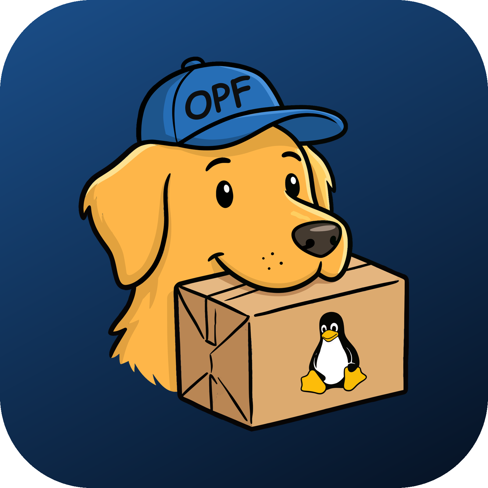

[English](../README.md) | **Português (BR)**

[](https://github.com/ph7ti/Offline-Package-Fetcher/actions/workflows/ci.yml)
[](https://github.com/ph7ti/Offline-Package-Fetcher/releases/latest)
[](https://go.dev/dl/)
[](../LICENSE)

<p align="center">
  
</p>

# Offline Package Fetcher (OPF)

**Baixe pacotes Linux e o conjunto completo de dependências para ambientes isolados — e, quando fizer sentido, transfira por SSH/SFTP e instale no destino.**

Versão **0.2.3** · Licença **GPL-3.0** · Go **1.27.4** · Linux, Windows e macOS (secundário)

---

## Visão geral

O **Offline Package Fetcher (OPF)** é uma ferramenta escrita em Go que automatiza o ciclo **download → verificação → transferência → instalação** de pacotes Linux e de todas as suas dependências. O download acontece em um **ambiente isolado** criado a partir da imagem (Docker) ou da distro (WSL) exatamente igual ao destino, de modo que os artefatos baixados sejam compatíveis com o servidor que vai recebê-los.

O OPF entrega três frentes que compartilham o mesmo núcleo:

| Frente | Binário | Interface | Build |
|:---|:---|:---|:---|
| CLI | `opf-cli` | flags POSIX, ideal para scripts e pipelines | `CGO_ENABLED=0` |
| TUI | `opf-tui` | terminal interativo (Bubble Tea) | `CGO_ENABLED=0` |
| GUI | `opf-gui` | desktop (Fyne) | `CGO_ENABLED=1` + bibliotecas gráficas |

### O problema que o OPF resolve

Ambientes isolados (segmentos de rede sem internet, clientes com proxy bloqueado, laboratórios de validação) não conseguem resolver dependências: o gerenciador de pacotes do destino falha somente no momento da instalação, quando já não há como baixar o que falta. O resultado é um ciclo de tentativa e erro com mídias físicas ou janelas de manutenção.

O OPF elimina esse retrabalho porque:

- resolve a árvore de dependências **antes** de sair do ambiente conectado;
- baixa tudo **uma única vez**, incluindo dependências opcionais quando solicitado;
- valida a integridade **três vezes** (ambiente isolado, host e destino);
- entrega os arquivos por SFTP e, se o operador confirmar, instala no destino;
- registra cada sessão em SQLite e permite exportar um relatório auditável.

Fluxo resumido de uma sessão:

```
1. você informa alvo + pacotes        →  2. OPF abre a sessão no SQLite
3. pré-check remoto (se houver SSH)   →  4. cria o ambiente isolado
5. resolve dependências e baixa       →  6. copia e valida no host (P1/P2)
7. gera SHA256SUMS                    →  8. envia por SFTP
9. valida no destino (P3)             →  10. pergunta se pode instalar
11. instala (dpkg/apt, yum/dnf, apk)  →  12. registra resultado
13. cleanup do ambiente e temporários
```

## Destaques

- **Três famílias de pacotes**: APT (Ubuntu/Debian), YUM/DNF (CentOS, RHEL, Rocky Linux, AlmaLinux, Fedora) e APK (Alpine).
- **Ambiente isolado por sessão**: Docker em todas as famílias; WSL no Windows para APT.
- **Pipeline de 13 etapas** com checkpoint, retomada segura, cancelamento (`abortada`) e cleanup garantido.
- **Integridade SHA-256 em três pontos** (P1 no ambiente, P2 no manifesto do host, P3 no destino) com um único `SHA256SUMS` por sessão.
- **Múltiplos pacotes por sessão**, com pré-check remoto de pacotes já instalados e `--force-reinstall` quando necessário.
- **SSH/SFTP** com verificação estrita de host key, autenticação por chave ou senha e **cadeia de pontes (jump hosts)** com credenciais independentes por salto.
- **Instalação remota** apenas após confirmação explícita, com `sudo` pela senha da conta SSH enviada **somente por stdin**.
- **Repositórios adicionais** (APT/RPM/APK) usados apenas no ambiente isolado, com GPG/TLS verificados por padrão.
- **Relatórios JSON e Markdown** por sessão, além de **Syslog externo** opcional (UDP/TCP, RFC 5424).
- **Histórico local** em SQLite (sessões, pacotes, eventos, etapas e pacotes solicitados) com arquivamento lógico.
- **Idioma da interface seguindo o sistema operacional** (inglês quando o idioma do SO não é suportado), com inglês, português do Brasil e espanhol disponíveis; selecionável em **Configurações Globais** (GUI e TUI) ou por `--lang`/`OPF_LANG` na CLI.

## Alvos suportados

| Família | Alvos (`--target`) | Gerenciador | Artefato | Presets validados |
|:---|:---|:---|:---|:---|
| APT | `ubuntu`, `debian` | `apt` / `dpkg` | `.deb` | Ubuntu 22.04, Ubuntu 24.04, Debian 12 |
| RPM | `centos`, `rhel`, `rockylinux`, `almalinux`, `fedora` | `yum` / `dnf` | `.rpm` | CentOS 7 (imagem preparada), CentOS Stream 9, Rocky Linux 9, AlmaLinux 9, Fedora 41, RHEL 9 (UBI) |
| APK | `alpine` | `apk` | `.apk` | Alpine 3.20 |

Métodos de fetch:

| Método | Plataformas | Famílias | Requisito |
|:---|:---|:---|:---|
| `docker` | Linux, macOS, Windows | todas | daemon Docker acessível |
| `wsl` | Windows | apenas APT | WSL2 com distro registrada e acesso `root` |

Arquiteturas reconhecidas: `amd64`/`x86_64`, `arm64`/`aarch64`, `armhf`/`armv7l` e `i386`/`i686` (normalizadas por família: `amd64` no APT, `x86_64` no RPM, entre outras).

Limites conhecidos da v0.2.3:

- **macOS** é plataforma secundária e requer Docker para baixar pacotes.
- **WSL** atende apenas Ubuntu/Debian (APT); famílias RPM/APK exigem Docker.
- **Instalação remota** exige SSH configurado, confirmação explícita e, se o usuário não for `root`, a senha da conta para `sudo`.
- **GUI** não compila com `CGO_ENABLED=0` (o binário resultante é apenas um stub com mensagem de erro).
- **Repositórios adicionais** não aceitam autenticação (usuário/senha) nesta versão.
- **Idioma da interface:** os diagnósticos de baixo nível permanecem em português do Brasil mesmo com outro idioma selecionado: saída dos gerenciadores de pacotes e do ambiente isolado (apt/dpkg, dnf/yum/rpm, apk, ferramentas Docker/WSL), causas de erro das camadas de fetch/transferência/instalação/armazenamento e parte das linhas de log interna.
- **Empacotamento da release:** executáveis Windows são distribuídos brutos dentro de `.zip` (sem UPX), formato aceito pelo Cortex XDR e EDRs similares; binários macOS são `.tar.gz` porque o UPX não empacota Mach-O. Assinatura de código é recomendada para ampliar a confiança.
- **Testes de integração** dependem da build tag `integration` e de Docker (e WSL nos testes específicos).

## Como funciona (arquitetura)

```
┌──────────────────────────────────────────────────────────────────────┐
│ Apresentação                                                         │
│  cmd/opf-cli          cmd/opf-tui            cmd/opf-gui             │
│  (flag stdlib)        ui/tui (Bubble Tea)    ui/gui (Fyne, CGO=1)    │
├──────────────────────────────────────────────────────────────────────┤
│ Casos de uso                                                         │
│  internal/app    Config · Service · detecção de alvo · jump hosts    │
├──────────────────────────────────────────────────────────────────────┤
│ Núcleo                                                               │
│  internal/core        Sessao · PipelineConfig · ExecutarPipeline     │
│  internal/fetcher     DockerFetcher · WSLFetcher                     │
│  internal/resolver    AptResolver · YumDnfResolver · ApkResolver     │
│  internal/transfer    SSHTransferManager · manifesto SHA256SUMS      │
│  internal/installer   AptInstaller · YumDnfInstaller · ApkInstaller  │
│  internal/inspector   pré-check remoto · host info                   │
├──────────────────────────────────────────────────────────────────────┤
│ Persistência e observabilidade                                       │
│  internal/store          SQLite (WAL): sessoes, pacotes, eventos,    │
│                          etapas_sessao, pacotes_solicitados          │
│  internal/observability  relatórios JSON/Markdown · Syslog RFC 5424  │
│  internal/config         config.json global (nunca com segredos)     │
└──────────────────────────────────────────────────────────────────────┘
```

O núcleo depende apenas de interfaces (`PackageFetcher`, `DependencyResolver`, `TransferManager`, `InstallExecutor`), portanto GUI, TUI e CLI não duplicam regras de negócio.

## Requisitos

| Recurso | Necessário para | Observação |
|:---|:---|:---|
| Go 1.27.4 | compilar do código | `go.mod` declara `go 1.27.4` |
| Docker Engine + daemon | `--fetch-method docker` | imagens são baixadas em tempo de execução |
| WSL2 + distro registrada | `--fetch-method wsl` (Windows) | somente Ubuntu/Debian (APT) |
| Servidor SSH no destino | transferência, pré-check e instalação | host key deve constar em `known_hosts` |
| Rede para os repositórios | download | o destino não precisa de internet |
| `gcc` + libs gráficas | GUI (`opf-gui`) | Linux: `libgl1-mesa-dev`, `xorg-dev`; Windows: `mingw-w64`; macOS: Xcode CLT |

## Instalação

### A. Binários da release

1. Abra [a página da release v0.2.3](https://github.com/ph7ti/Offline-Package-Fetcher/releases/tag/v0.2.3).
2. Baixe o binário da sua plataforma e o arquivo de checksums publicado junto. Cada release publica 15 ativos: `opf-cli-linux-amd64`, `opf-cli-linux-arm64`, `opf-cli-windows-amd64.exe.zip`, `opf-cli-darwin-amd64.tar.gz`, `opf-cli-darwin-arm64.tar.gz`, as mesmas cinco variantes de `opf-tui`, `opf-gui-linux-amd64`, `opf-gui-windows-amd64.exe.zip`, `opf-gui-darwin-amd64.tar.gz`, `opf-gui-darwin-arm64.tar.gz` e `SHA256SUMS`. Binários Linux usam UPX; executáveis Windows são publicados **brutos dentro de `.zip`** (extraia com `Expand-Archive` ou qualquer ferramenta zip); binários macOS ficam em `.tar.gz` (extraia com `tar -xzf <ativo>.tar.gz`).
3. Confira a integridade do download:

```bash
sha256sum -c SHA256SUMS
```

```powershell
$line = Get-Content .\SHA256SUMS | Where-Object { $_ -match 'opf-cli-windows-amd64\.exe\.zip$' }
$expected = ($line -split '\s+')[0]
if ((Get-FileHash .\opf-cli-windows-amd64.exe.zip -Algorithm SHA256).Hash -ne $expected.ToUpper()) {
    throw 'checksum mismatch'
}
```

Os binários `opf-cli` e `opf-tui` são estáticos (`CGO_ENABLED=0`). O `opf-gui` depende das bibliotecas gráficas da máquina, por isso é compilado com `CGO_ENABLED=1` (`make build-gui`).

Os ativos Linux de CLI/TUI e GUI recebem strip com `-trimpath -ldflags "-s -w -buildid="` e são comprimidos com UPX (`--best --lzma`): no linux/amd64, o CLI cai de 14,5 MB para 4,7 MB, a TUI de 15,4 MB para 4,9 MB e a GUI de 33,8 MB para 12,3 MB. Executáveis Windows **não usam UPX** — o Cortex XDR bloqueia PE empacotado — e são publicados brutos dentro de `.zip` (~6,1/6,4 MB para CLI/TUI e ~15,6 MB para a GUI). Binários macOS não podem ser empacotados pelo UPX e são publicados como `.tar.gz` (~5,6–6,3 MB em vez de 13,8–15,5 MB). Assinatura de código com certificado confiável é recomendada para ampliar a confiança, mas não é necessária para o Cortex XDR executar o binário Windows extraído.

### B. Compilar do código (Linux e macOS)

```bash
git clone https://github.com/ph7ti/Offline-Package-Fetcher.git
cd Offline-Package-Fetcher
mkdir -p bin

# CLI e TUI: Go puro, sem CGO
make build          # bin/opf-cli
make build-tui      # bin/opf-tui

# Cross-compilação do CLI para Linux amd64
make build-linux    # bin/opf-cli-linux-amd64
```

Os alvos do Makefile usam as flags de produção `-trimpath -ldflags "-s -w -buildid="`, então builds locais ficam alinhados aos binários publicados nesse aspecto. No Linux e no Windows, `make compress` opcionalmente empacota os binários com UPX (`--best --lzma`) e verifica cada um com `upx -t`; binários macOS não são tocados porque o UPX não empacota Mach-O.

### C. Compilar no Windows (PowerShell)

```powershell
# Go 1.27.4 instalado e disponível no PATH (go version => go1.27.4)
New-Item -ItemType Directory -Force bin | Out-Null
$env:CGO_ENABLED = '0'
go build -trimpath -ldflags "-s -w -buildid=" -o bin/opf-cli.exe ./cmd/opf-cli
go build -trimpath -ldflags "-s -w -buildid=" -o bin/opf-tui.exe ./cmd/opf-tui
```

### D. GUI (Fyne)

```bash
make build-gui      # bin/opf-gui — exige CGO_ENABLED=1 e as libs gráficas
```

Pré-requisitos por plataforma:

- **Linux (Debian/Ubuntu)**: `sudo apt-get install gcc libgl1-mesa-dev xorg-dev`
- **Windows**: toolchain `gcc` (mingw-w64) no `PATH`
- **macOS**: `xcode-select --install`

Sem CGO, `opf-gui` compila apenas um stub que encerra com a mensagem `opf-gui requer CGO_ENABLED=1 e as bibliotecas gráficas do Fyne; use make build-gui`.

## Início rápido

Todos os exemplos usam `opf-cli`. Troque `opf-cli` por `opf-tui` ou `opf-gui` para a interface interativa.

**1. Apenas baixar (Ubuntu 22.04)**

```bash
opf-cli --target ubuntu:22.04 --arch amd64 --pkg vim --pkg git
```

**2. Vários pacotes e dependências opcionais (CentOS 7)**

```bash
opf-cli --target centos:7 --arch x86_64 --pkg nginx,curl --with-optional
```

**3. Baixar pelo WSL (Windows, apenas APT)**

```bash
opf-cli --target ubuntu:22.04 --arch amd64 --pkg htop --fetch-method wsl --wsl-distro Ubuntu-22.04
```

**4. Detectar o alvo pelo SSH e transferir os arquivos**

```bash
opf-cli --pkg postgresql --ssh-host 10.20.0.15 --ssh-user opf \
  --ssh-key ~/.ssh/id_ed25519 --out ./opf-output
```

Sem `--target` e `--arch`, o OPF lê `/etc/os-release` e `uname -m` no destino e preenche distro, versão, arquitetura e imagem recomendada.

**5. Transferir e instalar com sudo**

```bash
export OPF_SSH_PASSWORD='senha-da-conta'
opf-cli --pkg nginx --ssh-host 10.20.0.15 --ssh-user opf \
  --ssh-password "$OPF_SSH_PASSWORD" --install --sudo --yes
```

`--yes` dispensa o prompt interativo, mas continua exigindo `--install`. Sem `--yes`, o OPF pergunta `Instalar N pacotes em usuario@host? [y/N]`.

**6. Repositório adicional + relatório exportado (Alpine 3.20)**

```bash
opf-cli --target alpine:3.20 --arch x86_64 --pkg curl \
  --repo-url https://repo.interno/alpine/v3.20/main \
  --repo-key ./interno.rsa.pub \
  --export-json ./opf-output/relatorio.json \
  --export-markdown ./opf-output/relatorio.md
```

O diretório de saída padrão é `./opf-output`, o banco padrão é `./opf.db` e o destino remoto padrão é `/tmp/opf-sessao-<id>`.

## GUI e TUI

- **GUI** (`opf-gui`): painel inicial com indicadores e sessões recentes, configuração de sessão, conexão SSH com detecção de destino e pontes, pacotes e pré-check, execução com etapas e log em tempo real, confirmação de instalação, resultado, relatório renderizado, histórico e configurações globais. Tema claro/escuro alternável.
- **TUI** (`opf-tui`): o mesmo fluxo em terminal, com atalhos como `ctrl+d` (detectar destino), `ctrl+t` (testar SSH), `ctrl+j` (pontes), `ctrl+r` (repositórios), `J`/`M` (exportar relatório) e `S` (enviar ao Syslog).

O passo a passo completo, tela por tela e tecla por tecla, está no [manual do usuário](MANUAL.pt-BR.md#6-gui-passo-a-passo).

## Documentação

| Documento | Conteúdo |
|:---|:---|
| [Manual do usuário (PT-BR)](MANUAL.pt-BR.md) | referência completa de flags, telas, pipeline, SQLite, relatórios e troubleshooting |
| [User manual (EN)](MANUAL.md) | the same operational manual in English |
| [README (EN)](../README.md) | página inicial em inglês |
| [Segurança (PT-BR)](SECURITY.pt-BR.md) | modelo de ameaças, controles e política de divulgação |
| [Security (EN)](SECURITY.md) | security model and disclosure policy in English |
| [Documento técnico (PT-BR)](project-description.pt-BR.md) | requisitos, ADRs, contratos e roadmap |
| [Especificação GUI/TUI (PT-BR)](specs/gui-tui.pt-BR.md) | inventário de telas e decisões de interface |
| [Changelog](../CHANGELOG.md) | histórico de versões |
| [Licença](../LICENSE) | texto da GPL-3.0 |

## Estrutura do projeto

```
Offline-Package-Fetcher/
├── cmd/
│   ├── opf-cli/            # CLI (flags, validações, confirmação de instalação)
│   ├── opf-tui/            # TUI Bubble Tea
│   └── opf-gui/            # GUI Fyne (stub sem CGO)
├── internal/
│   ├── app/                # casos de uso compartilhados, detecção de alvo, jumps
│   ├── core/               # contratos, sessão, pipeline de 13 etapas
│   ├── fetcher/            # DockerFetcher, WSLFetcher, repositórios adicionais
│   ├── resolver/           # APT, YUM/DNF e APK
│   ├── transfer/           # SSH/SFTP, manifesto SHA256SUMS
│   ├── installer/          # dpkg/apt, yum/dnf, apk
│   ├── inspector/          # pré-check remoto e host info
│   ├── store/              # SQLite (modernc.org/sqlite, WAL)
│   ├── observability/      # relatórios JSON/Markdown e Syslog RFC 5424
│   └── config/             # configurações globais não sensíveis
├── ui/
│   ├── gui/                # telas Fyne
│   └── tui/                # telas Bubble Tea
├── docker/                 # Dockerfiles das imagens de teste/download
├── test/integration/       # testes com build tag `integration`
├── docs/                   # documentação EN/PT-BR
├── images/                 # ícones do aplicativo
├── Makefile
└── go.mod
```

## Segurança em destaque

| Controle | Comportamento padrão |
|:---|:---|
| Host key SSH | verificação **estrita** via `known_hosts` em todos os saltos |
| Bypass de host key | apenas opt-in explícito (`--ssh-insecure-skip-host-key`), com aviso |
| Sudo | senha da conta SSH por `stdin` (`sudo -S`); NOPASSWD não é suportado |
| Segredos | nunca gravados em SQLite, JSON de sessão, relatório ou log |
| Integridade | SHA-256 em P1/P2/P3 + manifesto `SHA256SUMS` por sessão |
| Assinaturas | GPG/TLS de repositórios verificados por padrão; opt-in inseguro explícito |
| Nomes e caminhos | validação de pacote/alvo/repositório e shell quoting dos artefatos |
| Instalação | sempre exige confirmação explícita antes de qualquer comando remoto |
| Cleanup | ambiente isolado e temporários locais removidos mesmo em falha |

O modelo completo está em [SECURITY.pt-BR.md](SECURITY.pt-BR.md).

## Desenvolvimento

| Comando | O que faz |
|:---|:---|
| `make build` | compila `bin/opf-cli` com `CGO_ENABLED=0` |
| `make build-tui` | compila `bin/opf-tui` com `CGO_ENABLED=0` |
| `make build-linux` | cross-compila `bin/opf-cli-linux-amd64` |
| `make build-gui` | compila `bin/opf-gui` com `CGO_ENABLED=1` |
| `make test` | `CGO_ENABLED=0 go test ./...` |
| `make test-integration` | `go test -tags=integration -count=1 -timeout=30m ./...` |
| `make docker-test-image` | constrói `opf/ubuntu-22.04:f0` a partir de `docker/ubuntu-22.04.Dockerfile` |
| `make clean` | remove `bin/` |

Notas:

- Os testes unitários não precisam de Docker nem de SSH.
- Os testes de integração usam a build tag `integration`, exigem Docker (e WSL nos testes `windows`) e baixam imagens reais.
- `CGO_ENABLED=0` deve continuar compilando todo o núcleo, o CLI e a TUI; a GUI é a única exceção (`ADR-11`).

## Contribuição

1. Abra uma issue descrevendo o cenário (distro/versão, família, método de fetch).
2. Crie um branch a partir de `main` com um nome descritivo.
3. Mantenha `gofmt`, adicione testes para o comportamento novo e rode `make test`.
4. Envie o pull request explicando o impacto em CLI, TUI e GUI.

Vulnerabilidades não devem ser abertas como issue pública: siga a política descrita em [SECURITY.pt-BR.md](SECURITY.pt-BR.md).

## Licença

Distribuído sob a **GNU General Public License v3.0**. Consulte [LICENSE](../LICENSE) para o texto completo.

## Desenvolvimento com apoio de IA

O OPF foi desenvolvido com **apoio intensivo de ferramentas de IA** — geração de código, testes, revisão e documentação — sempre sob decisão e validação humanas. Isso é divulgado de forma transparente porque influencia como o projeto deve ser avaliado:

- todo o código-fonte é aberto e pode ser auditado;
- o comportamento é coberto por testes unitários, de integração e de segurança;
- contribuições humanas são bem-vindas para revisar trechos sensíveis (SSH, sudo, integridade e instalação remota);
- nenhuma garantia além da GPL-3.0 é oferecida; valide em laboratório antes de usar em produção.

## Versão

**Versão 0.2.3** — release atual. Consulte o [changelog](../CHANGELOG.md), o [manual do usuário](MANUAL.pt-BR.md) e o [documento técnico](project-description.pt-BR.md).

[English](../README.md) | **Português (BR)**
